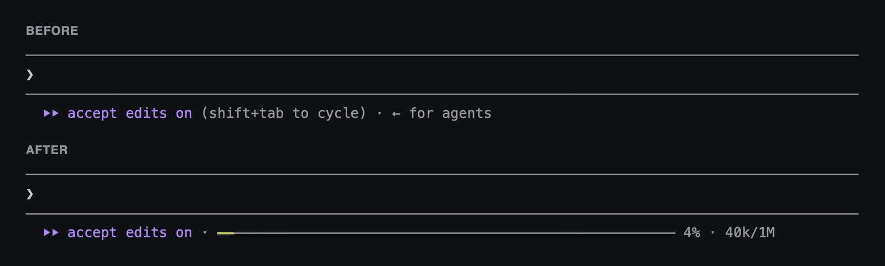

# Slimbar

Claude Code's footer, reduced to one row and one signal: how full your context is.

No status line, no extra row, nothing to configure.



<sub>Real Claude Code output. The token figures are illustrative.</sub>

## Install

At the prompt of a terminal session:

```
/plugin install slimbar --marketplace renanpallin/claude-slimbar
```

Confirm the marketplace and pick a scope. If the row doesn't appear, run `/reload-plugins`.

If you use a status line, remove the `statusLine` key from `~/.claude/settings.json`. Otherwise it keeps its own row above this one.

<details>
<summary>From a shell, or in the desktop app</summary>

From a shell, then start a new session:

```
claude plugin install slimbar --marketplace renanpallin/claude-slimbar
```

The desktop app's local sessions read the same settings, so a user-scope install from a shell applies there too.

</details>

Needs Claude Code 2.1.287 or later, or 2.1.292 for the shell command. Tested on 2.1.319, in the terminal, with both the classic and the fullscreen renderer.

Not affiliated with Anthropic.

## What it does

Slimbar is a [mod](https://code.claude.com/docs/en/plugins/mods/overview) that replaces the footer's hint line:

```
⏵⏵ bypass permissions on · ━━━━━━━━━─────────────────────────────── 23% · 230k/1M · ← 2
```

- `(shift+tab to cycle)`, `? for shortcuts` and `← for agents` go away.
- `← 2 agents` becomes `← 2`.
- Other notices, such as `esc to interrupt`, stay when they fit.

## What it can access

A mod runs with your permissions, so it's worth knowing what this one does. [The whole mod](hooks/register.tsx) is about 130 lines with no dependencies. It reads the session's token usage and draws one row, and it watches tool calls, turns and compactions only to know when to redraw. It doesn't read files, run commands or use the network.

To check, run `claude plugin validate` on a clone. It reports:

```
hooks: ui.render{component=PromptHint}, tool.call, turn.complete, session.compact
calls: $.session.usage, $.ui.invalidate, $.ui.resolve
```

## Colors

The color follows the tokens in context, not the percentage of the window, because a 1M window and a 200k window hold very different amounts at the same percentage.

| Window | Green | Yellow: consider a new session | Red: be careful | Auto-compaction, when on |
| --- | --- | --- | --- | --- |
| 1M | under 150k | 150k to 399k | 400k or more | about 967k |
| 200k | under 80k | 80k to 149k | 150k or more | about 200k |

**These are reference points, not measurements.** Anthropic [says response quality degrades as a conversation grows](https://platform.claude.com/docs/en/build-with-claude/compaction), but no model publishes where that starts.

- 150k is the Claude API's [default compaction trigger](https://platform.claude.com/docs/en/build-with-claude/compaction-threshold).
- 400k on a 1M window and 80k on a 200k window apply the [rule of thumb of being careful past 40% of the window](https://arxiv.org/pdf/2606.27045), which is not a proven threshold.
- The auto-compaction column comes from the [Claude Code docs](https://code.claude.com/docs/en/model-config#default-auto-compact-thresholds).

Starting a new session for each new task remains [Anthropic's own advice](https://claude.com/resources/articles/using-claude-code-session-management-and-1m-context), whatever the bar shows.

## Minimal setup

Slimbar only changes the footer. Claude Code's [own settings](https://code.claude.com/docs/en/settings-reference) can quiet the rest, with or without this mod. Add the ones you want to `~/.claude/settings.json`:

```json
{
  "tui": "fullscreen",
  "viewMode": "focus",
  "spinnerTipsEnabled": false,
  "showTurnDuration": false,
  "awaySummaryEnabled": false,
  "promptSuggestionEnabled": false
}
```

| Setting | What it does |
| --- | --- |
| `tui` | Uses the fullscreen renderer, a research preview that focus view needs |
| `viewMode` | Shows only your last prompt, a one-line summary of tool calls and the final response |
| `spinnerTipsEnabled` | Hides the tips in the spinner |
| `showTurnDuration` | Hides the "Cooked for 1m 6s" line after each response |
| `awaySummaryEnabled` | Hides the session recap when you come back |
| `promptSuggestionEnabled` | Hides the grayed-out suggestions in the prompt |

To remove the pull request badge from the footer as well, turn off **Show PR status footer** in `/config`.

## Update and uninstall

Third-party marketplaces don't update by themselves, so a fix won't reach you until you ask for it:

```
claude plugin update slimbar@claude-slimbar
```

To get updates automatically, run `/plugin`, open the **Marketplaces** tab, select `claude-slimbar`, then **Enable auto-update**.

To remove it and get the original footer back:

```
claude plugin uninstall slimbar@claude-slimbar
```

## Limits

- **The permission mode label stays.** Claude Code draws `⏵⏵ bypass permissions on` by itself, in every mode, and a mod can't replace it. The bar leaves room for the longest label, so it ends a little earlier in modes with a shorter one.
- **The bar is shorter in the classic renderer.** It leaves 20 columns for what Claude Code shows at the footer's right, such as `◐ medium · /effort` at startup. Anything wider takes a second row while it shows. In fullscreen, that startup notice floats above the prompt, so the bar gets the room.
- **Short rows give things up.** Notices that don't fit are left out, and the figures and at least 10 cells of bar stay. Under 77 columns in the classic renderer, the bar keeps the notice's room, so `/effort` takes a second row for a few seconds at startup. Under about 57 columns the bar shrinks away, and under about 45 the row can wrap.
- **Notices stop being clickable.** A rewritten hint line is plain text.
- **The hint's wording matters.** The mod removes reminders by matching their text, so a future Claude Code release that rewords them could bring them back.
- **The VS Code panel doesn't change.** It has no hint line to replace. `claude` in VS Code's integrated terminal works.
- **The desktop app is untested.** It has the same hint line, but the layout has only been checked in the terminal.

## Similar projects

Other mods also show your context near the prompt, and may suit you better. This comparison comes from their READMEs, as of November 2026.

| Project | What it offers |
| --- | --- |
| [aspatari/footline](https://github.com/aspatari/footline) | One footer row with branch, pull requests, model, effort, context and limits |
| [hamzafer/claude-code-mods](https://github.com/hamzafer/claude-code-mods) | A collection of mods, with a `context-bar` line above the prompt, split by what fills your context |
| [Amnesiac9/claude-mods](https://github.com/Amnesiac9/claude-mods) | A `context-bar` in the footer with configurable glyphs and width, colored by percentage |
| [koprjaa/claude-code-context-bar](https://github.com/koprjaa/claude-code-context-bar) | A bar at the right end of the footer, with a breakdown on hover |

Status lines such as [CCometixLine](https://github.com/Haleclipse/CCometixLine) and [claude-statusline](https://github.com/nilbuild/claude-statusline) show much more, in a row of their own.

Slimbar's focus is the smallest footer: one row, one signal, and colors set by tokens rather than by percentage.

## Develop

```
claude --plugin-dir .      # run a session with this folder loaded
claude plugin test .       # run the tests
claude plugin validate .   # check the manifest and hooks
claude plugin tag --push   # tag a release, after bumping the version
```

## License

MIT
